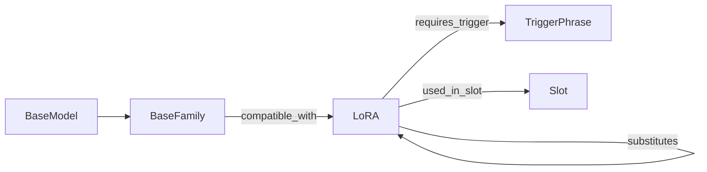

# 模型兼容图谱摘要（P2）

## 图谱摘要（自动 · 2026-10-26 04:43 Asia/Shanghai）

| 项 | 值 |
|----|----|
| phase | `P2` |
| 节点 | 679 |
| 边 | 2142 |
| compatible A/B/C | 21 / 159 / 153 |
| requires_trigger | 153 |
| conflicts_with | 36 |
| substitutes | 22 |

节点类型：{'BaseFamily': 17, 'EngineSlot': 3, 'BaseModel': 40, 'LoRA': 351, 'PurposeTag': 33, 'SourceCard': 124, 'TriggerPhrase': 111}  
边类型：{'instance_of': 40, 'purpose': 351, 'recommended_strength': 351, 'compatible_with': 333, 'used_in_slot': 672, 'sourced_from': 184, 'conflicts_with': 36, 'requires_trigger': 153, 'substitutes': 22}

> 日期：2026-10-26（Asia/Shanghai）  
> 生成：`scripts/ops/build-model-compat-graph.py` → `generated/model-compat-graph.json`  
> 拍板：D1 灰显可强制 · D2 H3 严格分族 · D3 JSON · D4 并列 join
> P2：文件级 conflicts_with + substitutes + catalog/产品 A；无 LoRA 实测回写；P1.5b 强度/trigger 保留

- inventory 白名单 LoRA 节点：**351**
- 节点合计：**679** · 边合计：**2142**
- compatible_with 按置信度：A=45 B=247 C=753（含非 compatible 边的 conf 计数，见 stats）
- catalog 命中：21 · civ baseModels 边：130 · Qwen 包 B：51
- requires_trigger：ms=5 civ=136 · strength catalog/ms/civ/heuristic=21/1/17/312 · p1b_base=37

## 按 BaseFamily 的兼容边（confidence 计数）

| family | A | B | C |
|--------|---|---|---|
| `flux.1-d` | 0 | 21 | 11 |
| `flux.2-klein` | 0 | 1 | 5 |
| `hunyuan-video` | 0 | 1 | 1 |
| `illustrious` | 0 | 7 | 2 |
| `krea-2` | 0 | 2 | 0 |
| `ltx-2.3` | 2 | 7 | 37 |
| `ltx-legacy` | 0 | 1 | 0 |
| `minimax-h3` | 13 | 11 | 9 |
| `noobai` | 0 | 1 | 0 |
| `pony` | 0 | 3 | 0 |
| `qwen-image` | 0 | 54 | 0 |
| `sd15` | 0 | 3 | 1 |
| `sdxl` | 0 | 7 | 9 |
| `wan2.2-i2v-a14b` | 6 | 20 | 46 |
| `wan2.2-t2v-a14b` | 0 | 10 | 22 |
| `wan2.2-ti2v` | 0 | 4 | 0 |
| `z-image-turbo` | 0 | 6 | 10 |

## 种子 BaseModel

- `Qwen-Rapid-AIO-SFW-v23.safetensors` → `family:qwen-image`（Qwen Rapid AIO SFW v23）
- `minimax_h3_fl2va_pruned_int8_convrot.safetensors` → `family:minimax-h3`（H3 FL2VA pruned int8）
- `minimax_h3_ref2va_pruned_int8_convrot.safetensors` → `family:minimax-h3`（H3 REF2VA pruned int8）

## 使用

- 前端：`src/lib/model-compat.ts` + 设置页 LoRA 管理按当前底模族过滤
- Agent：`queryCompat({ baseId|family, slot, minConfidence })`
- 再生：`python3 scripts/ops/build-model-compat-graph.py`
